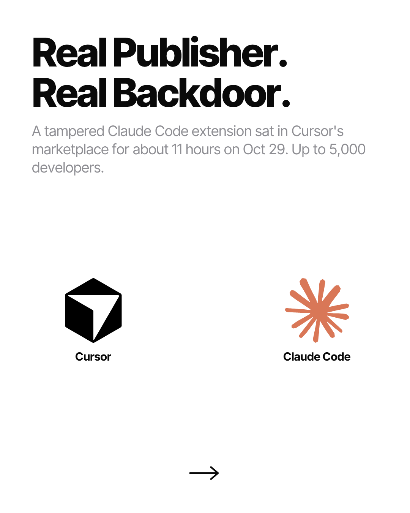
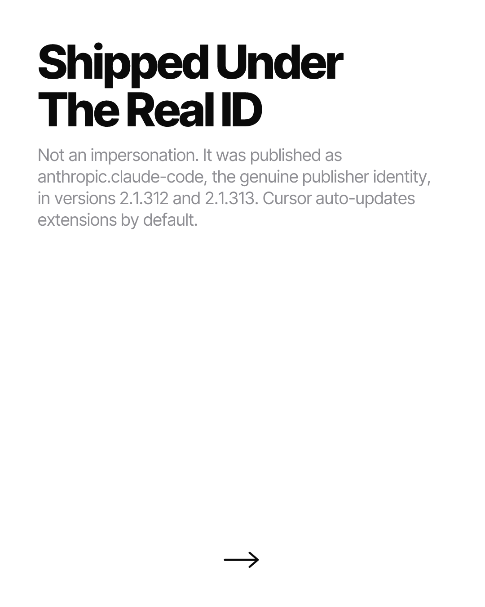
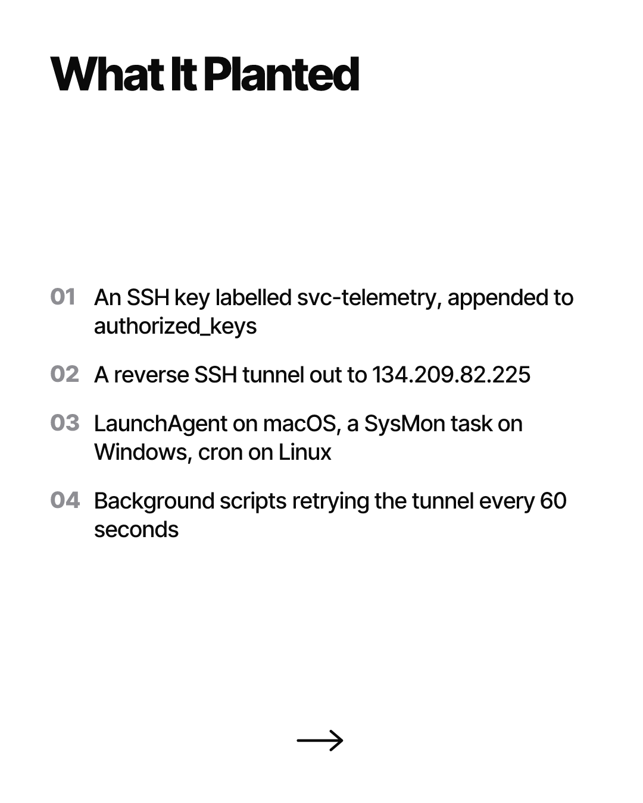
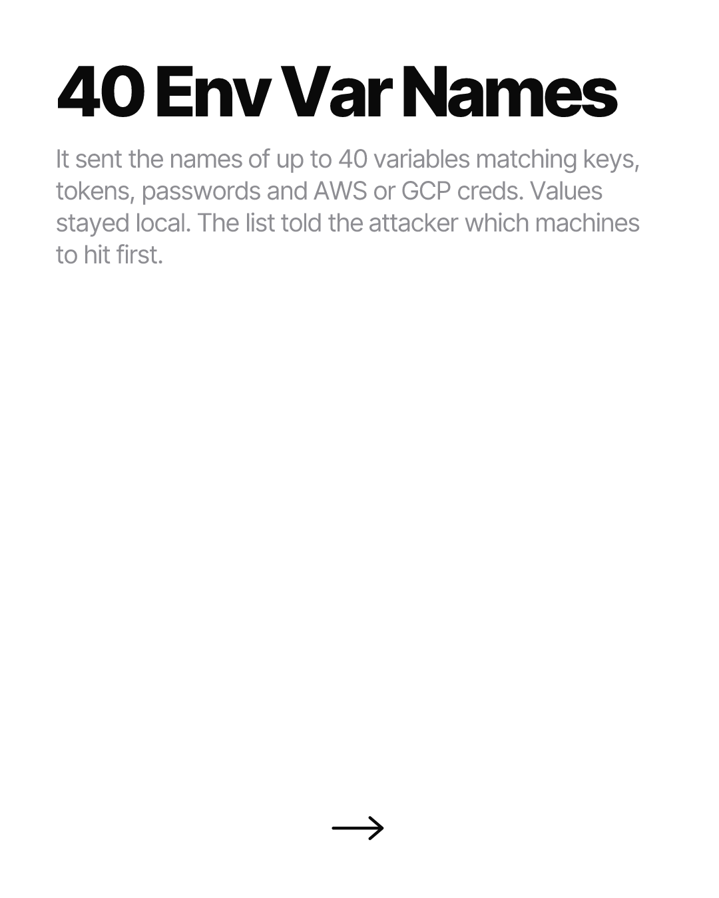
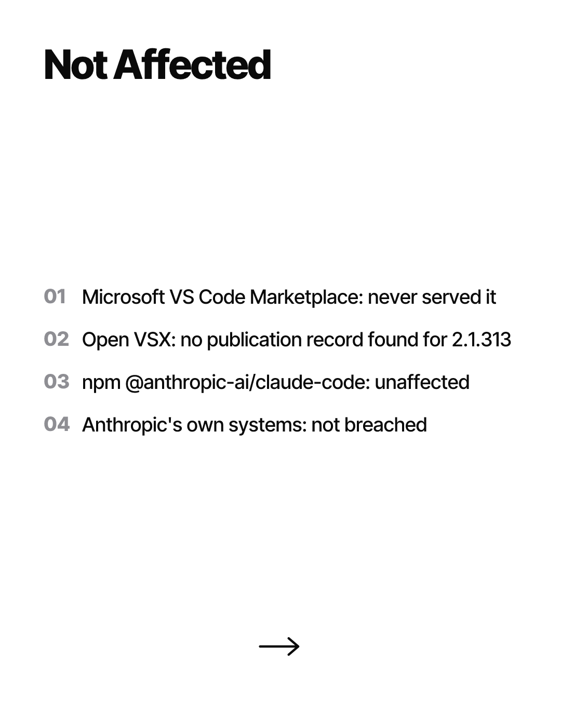
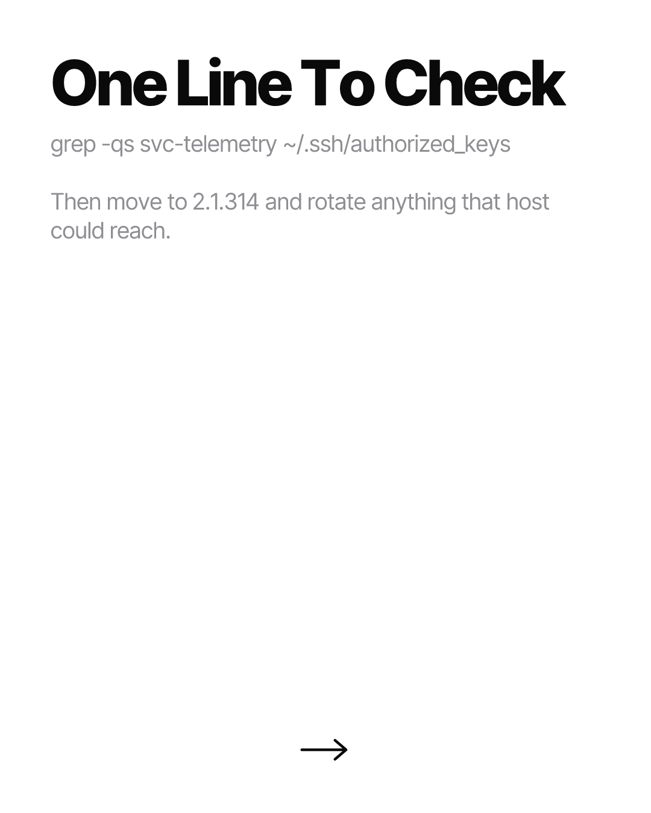

# Pending Notion row — "Instagram Carousel & Post Pipeline"

Could not be filed automatically. The Notion connector is unauthenticated in this session: it
exposes no tools at all (a tool search for Notion returns nothing), so there is no API path to
the database. No NOTION_TOKEN is set in this environment either, so the scripted path
(src/notion.ts) is also unavailable.

This is the NINTH consecutive day it has failed. Reconnect at
claude.ai -> Settings -> Connectors -> Notion. Backlog to paste, oldest first:
  NOTION-ROW-2026-10-23.md
  NOTION-ROW-2026-10-24.md
  NOTION-ROW-2026-10-25.md
  NOTION-ROW-2026-10-26.md
  NOTION-ROW-2026-10-27.md
  NOTION-ROW-2026-10-28.md
  NOTION-ROW-2026-10-29.md
  NOTION-ROW-2026-10-30.md
  NOTION-ROW-2026-10-31.md
  NOTION-ROW-2026-11-01.md  (this file)

Because the database could not be read, dedupe was done against the 86 posts already in
posts/ig/ plus the nine pending row files above, not against the live Topic column.

Everything below is final, rendered, pushed, and every slide URL verified HTTP 200.
Paste as one new row.

---

## Topic
Real Publisher. Real Backdoor.

## Ready to Post
Unchecked

## Image URL
https://raw.githubusercontent.com/SouSingh/ig-content-engine/main/posts/ig/2026-11-01/real-publisher-real-backdoor/01.png

## Bio
The publisher was real. That is the part that should scare you.

A tampered Claude Code extension sat in Cursor's marketplace for about 11 hours on Oct 29, reaching up to 5,000 developers. It went out under anthropic.claude-code, the genuine publisher ID, and Cursor auto-updates extensions by default. So most of the people who got it never chose to install anything. It planted an SSH key labelled svc-telemetry, installed persistence that retries every 60 seconds, and shipped the names of up to 40 env vars that looked like credentials.

My admission: I have never once audited what an editor extension does after it updates itself. I check the publisher and move on. That is the exact check that failed here.

Checked your authorized_keys yet?

#buildinpublic #indiehackers #solofounder #devtools #aicoding #claudecode #cursor #supplychainsecurity #devsecops #appsec #codingagents #softwareengineering

---

## Page body

### Carousel (embed each as an image block, in order)

### Raw URLs (for downloading)

https://raw.githubusercontent.com/SouSingh/ig-content-engine/main/posts/ig/2026-11-01/real-publisher-real-backdoor/01.png
https://raw.githubusercontent.com/SouSingh/ig-content-engine/main/posts/ig/2026-11-01/real-publisher-real-backdoor/02.png
https://raw.githubusercontent.com/SouSingh/ig-content-engine/main/posts/ig/2026-11-01/real-publisher-real-backdoor/03.png
https://raw.githubusercontent.com/SouSingh/ig-content-engine/main/posts/ig/2026-11-01/real-publisher-real-backdoor/04.png
https://raw.githubusercontent.com/SouSingh/ig-content-engine/main/posts/ig/2026-11-01/real-publisher-real-backdoor/05.png
https://raw.githubusercontent.com/SouSingh/ig-content-engine/main/posts/ig/2026-11-01/real-publisher-real-backdoor/06.png
https://raw.githubusercontent.com/SouSingh/ig-content-engine/main/posts/ig/2026-11-01/real-publisher-real-backdoor/07.png
https://raw.githubusercontent.com/SouSingh/ig-content-engine/main/posts/ig/2026-11-01/real-publisher-real-backdoor/08.png

### Sources

Cursor security notice (primary; updated Oct 30 to clarify 2.1.312 + 2.1.313, IOCs, remediation scripts)
https://cursor.com/blog/claude-code-extension-security-notice

Microsoft Security Blog — payload analysis; confirms VS Code Marketplace and npm unaffected
https://www.microsoft.com/en-us/security/blog/2026/10/30/inside-malicious-claude-code-branded-cursor-extension-persistent-ssh-backdoor/

OX Security — stage-by-stage teardown, persistence paths, IOC tables
https://www.ox.security/blog/malicious-claude-code-extension-cursor-ssh-backdoor/

Help Net Security — Phorion analysis; the "up to 40 env var names, values stay local" finding
https://helpnetsecurity.com/2026/10/30/claude-code-extension-ssh-backdoor

The Next Web — Anthropic's denial of a breach; auto-update default; 2.1.314 fix
https://thenextweb.com/news/tampered-claude-code-extension-cursor-ssh-backdoor

The Hacker News — distributed under the legitimate publisher identity, not a fake extension
https://thehackernews.com/2026/10/official-claude-code-vs-code-extension.html

Socket — found no Open VSX publication record for 2.1.313 (basis for slide 6, item 2)
https://socket.dev/blog/claude-code-extension-compromise

Sophos X-Ops — uninstalling leaves the backdoor in place
https://www.sophos.com/en-us/blog/malicious-claude-code-extension-distributed-through-cursor-marketplace

Claude Code changelog — confirms 2.1.312 (Oct 27) and 2.1.314 (Oct 30) as genuine releases
https://code.claude.com/docs/en/changelog

---

## Notes on this run

- Shape rotation: previous seven posts ran 7/6/5/7/4/7/6 slides. This is an 8-slide incident
  teardown — a shape not used in that window, and the first security-incident teardown since
  the back catalogue's npm/registry posts.
- Brandfetch returned 403 (no API credits on the plan) for get_brand_data, so no brand hex was
  pulled from it. brand_search is free and confirmed cursor.com as a real, verified brand.
  Logo colours fall back to the simple-icons brand hex: Claude #D97757, Cursor black.
- cdn.simpleicons.org is blocked by this session's network policy, so logos rendered from the
  bundled simple-icons npm package (src/assets.ts fallback). Both marks resolved — no lettermarks.
- "visualstudiocode" and "openvsx" are not in simple-icons v16, so the "Not Affected" slide is a
  text list rather than a logo grid, to avoid lettermark boxes.
- All 8 PNGs were opened and visually QA'd. No overflow, no clipped text.
