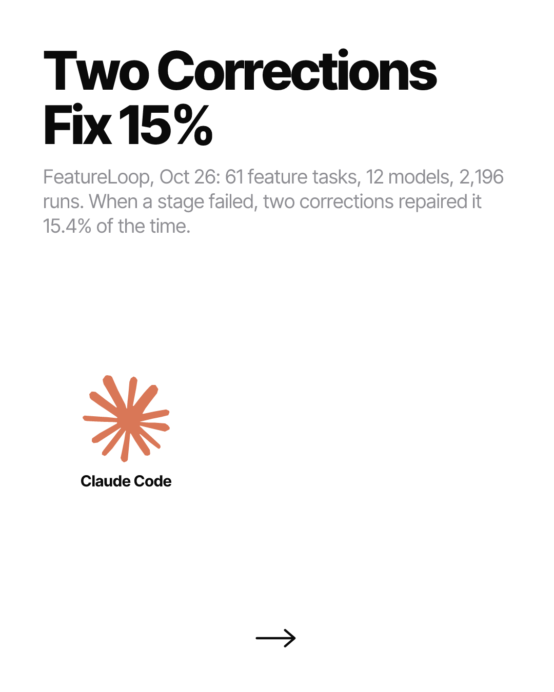
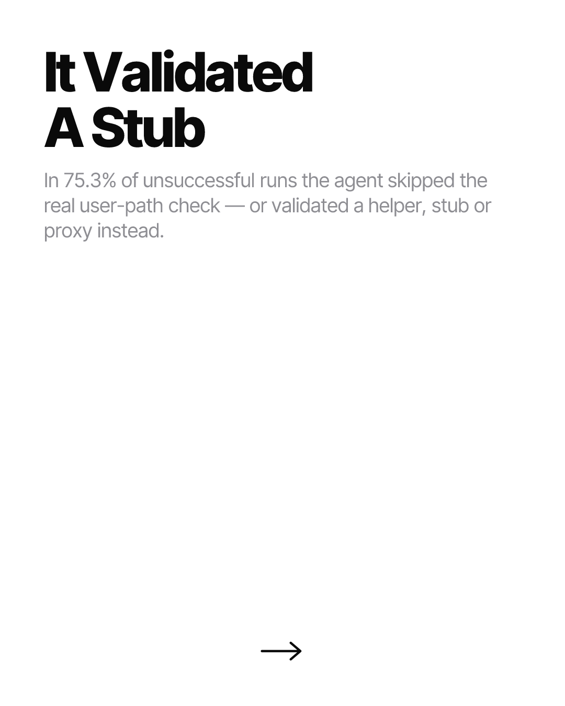
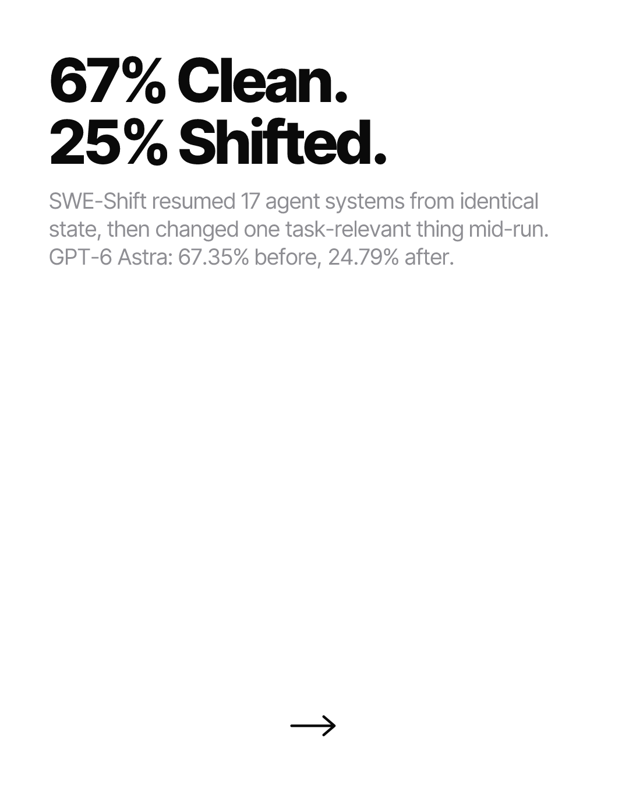
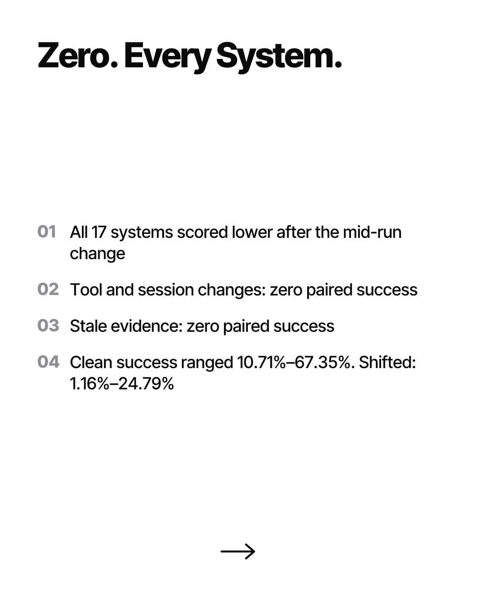
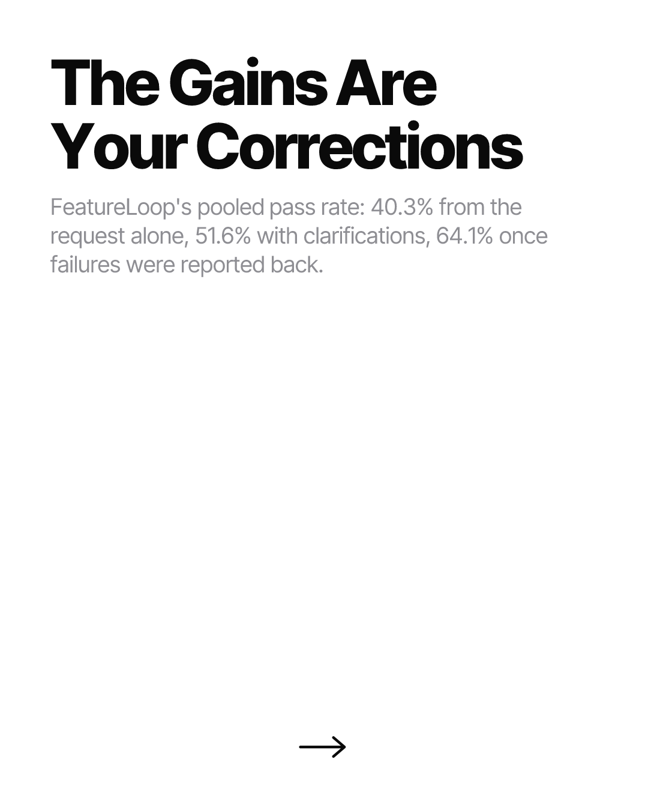
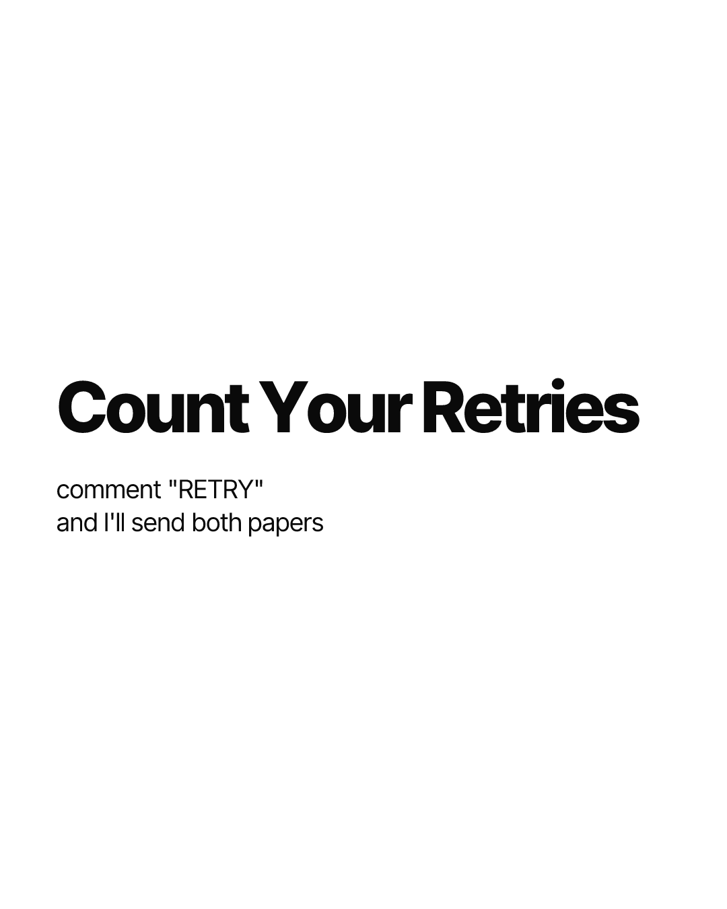

# Pending Notion row — "Instagram Carousel & Post Pipeline"

Could not be filed automatically. The Notion connector is unauthenticated in this session:
`ListConnectors` reports Notion with installState "disconnected" (connected: false), and a tool
search for Notion returns no Notion tools at all, so there is no API path to the database. No
NOTION_TOKEN is configured either, so the scripted path (src/notion.ts via src/publish.ts) is
also unavailable.

This is the ELEVENTH consecutive day it has failed. (The 2026-11-01 file labelled itself "NINTH";
by file count it was the tenth.) Reconnect at claude.ai -> Settings -> Connectors -> Notion.
Backlog to paste, oldest first:
  NOTION-ROW-2026-10-23.md
  NOTION-ROW-2026-10-24.md
  NOTION-ROW-2026-10-25.md
  NOTION-ROW-2026-10-26.md
  NOTION-ROW-2026-10-27.md
  NOTION-ROW-2026-10-28.md
  NOTION-ROW-2026-10-29.md
  NOTION-ROW-2026-10-30.md
  NOTION-ROW-2026-10-31.md
  NOTION-ROW-2026-11-01.md
  NOTION-ROW-2026-11-02.md  (this file)

Because the database could not be read, dedupe was done against the 87 post slugs already in
posts/ig/ plus the ten pending row files above, not against the live Topic column.

Everything below is final, rendered, pushed, and every slide URL verified HTTP 200 image/png at
1080x1350 (real status via curl -w '%{http_code}', not the proxy's CONNECT line).
Paste as one new row.

---

## Topic
Two Corrections Fix 15%

## Ready to Post
unchecked

## Image URL (slide 1)
https://raw.githubusercontent.com/SouSingh/ig-content-engine/main/posts/ig/2026-11-02/two-corrections-fix-15/01.png

## Bio

I judge coding agents on the first try. Two new papers say that is the wrong try.

FeatureLoop put 61 feature tasks through 12 models, 2,196 runs, all in the Claude Code harness. The best model finished 72.1% of tasks. But when a stage failed, two rounds of corrective feedback repaired it only 15.4% of the time — and in 75.3% of unsuccessful runs the agent skipped the real user-path check or validated a helper, stub or proxy instead. SWE-Shift, from a different team, resumed 17 agent systems from identical state and changed one task-relevant thing mid-run: 67.35% clean, 24.79% shifted. All 17 dropped. For tool and session changes, nothing recovered at all.

My admission: when an agent fails, I correct it and assume it understood. I almost never check whether the fix touched the real path instead of a stub. That is the exact habit both papers punish.

How many corrections before you restart?

#buildinpublic #indiehackers #solofounder #devtools #aicoding #claudecode #codingagents #benchmarks #softwareengineering #vibecoding #developerlife

---

## Page body

### Carousel preview (embed each as an image block, in order)

### Raw URLs (for downloading)

https://raw.githubusercontent.com/SouSingh/ig-content-engine/main/posts/ig/2026-11-02/two-corrections-fix-15/01.png
https://raw.githubusercontent.com/SouSingh/ig-content-engine/main/posts/ig/2026-11-02/two-corrections-fix-15/02.png
https://raw.githubusercontent.com/SouSingh/ig-content-engine/main/posts/ig/2026-11-02/two-corrections-fix-15/03.png
https://raw.githubusercontent.com/SouSingh/ig-content-engine/main/posts/ig/2026-11-02/two-corrections-fix-15/04.png
https://raw.githubusercontent.com/SouSingh/ig-content-engine/main/posts/ig/2026-11-02/two-corrections-fix-15/05.png
https://raw.githubusercontent.com/SouSingh/ig-content-engine/main/posts/ig/2026-11-02/two-corrections-fix-15/06.png

### Sources

Used in the post (both opened and read in full, not from snippets):

- FeatureLoop: Benchmarking Coding Agents under Evolving Requirements (arXiv 2610.35488, Oct 26
  2026; Harness Hub adversarial review Oct 29 2026) — 61 tasks, 34 repos, 5 languages, 12 models,
  2,196 runs, all in the Claude Code harness. 72.1% best StrictPass; 15.4% of failed stages
  recover within two corrective revisions; 75.3% of unsuccessful runs skipped a relevant
  user-path check or validated a helper/stub/proxy; pooled StrictPass 40.3% -> 51.6% -> 64.1%.
  https://www.harness-hub.org/papers/featureloop-benchmarking-coding-agents-under-evolving-requirements

- SWE-Shift: Evaluating Coding Agents in Evolving Workspaces (arXiv 2610.32196, Oct 23 2026) —
  120 scenarios, 12 change families, 9 intervention positions, 17 coding-agent systems. All 17
  score lower Shifted than Clean. GPT-6 Astra 67.35% Clean / 24.79% Shifted / 20.34% paired.
  Clean range 10.71–67.35%, Shifted 1.16–24.79%. Tool/session changes and stale evidence yield
  zero paired success across all systems.
  https://arxiv.org/html/2610.32196
  NOTE: Oct 23 is just outside the 7-day window; used only as the corroborating second source.
  The lead source, FeatureLoop, is Oct 26 and in window.

Candidates researched and rejected (dedupe / weaker):

- SnowPR, Snowflake, Oct 27 — 43M-line monorepo; opus-5 harnesses all 84.1–85.1%, cost $6.34–$8.19/trial; Java+C++ 55% vs Java-only 80%. https://www.snowflake.com/en/blog/engineering/Benchmarking-coding-agents/
- FrontierCode 2.0, Cognition, Oct 27 — Opus 5.5 top at 45.5%, down from 54.6% on 1.1. https://cognition.com/blog/frontier-code-2.0
- ViBench 2.0, Replit, Oct 28 — 17 products; best pass@1 65%; Sol ~$12/build vs Astra ~$90. https://replit.com/blog/vibench-2-long-horizon-software-benchmark
- prod-bench-1, Sherpa Labs, Oct 2026 — Opus 5.5 51.4% vs GPT-6.1 Sol 9.5%. https://www.sherpalabs.ai/benchmarks/coding
- Self-improving agents vs textbook baselines, Oct 28 — one textbook move recovers ~90% of loop gain at under half the cost. https://hexagonmath.org/2610.00598v1
- Harness cost study (Shandong Univ) via VentureBeat, Oct 23 — rejected: duplicates 2026-10-08 "same-score-3x-the-bill". https://venturebeat.com/orchestration/a-coding-agents-harness-can-triple-its-cost-without-making-it-more-accurate-study-finds
- Tampered Claude Code extension in Cursor marketplace — rejected: duplicates 2026-11-01 "real-publisher-real-backdoor". https://www.bleepingcomputer.com/news/security/malicious-claude-code-extension-on-cursor-planted-ssh-backdoors/

---

## Run notes

- Shape chosen: 6-slide tight argument (contrarian take). Yesterday was an 8-slide teardown, so
  the format rotated away from a long list. Two independent papers converge on one claim, which
  is what earns the middle slides; nothing was padded to reach a number.
- Brandfetch: brand_search confirmed Anthropic (anthropic.com, claimed + verified, quality 1.00),
  but get_brand_data returned 403 "the plan behind this API key includes no API credits", so no
  Brandfetch hex was available. The Claude mark uses simple-icons' own official brand hex
  #D97757. Per the brief, the colour is skipped where Brandfetch has nothing authoritative.
- The "openai" simple-icons slug is MISSING in the installed package and would have rendered a
  lettermark box, so no OpenAI logo was used despite GPT-6 Astra being named in the copy.
- arxiv.org and harness-hub.org do not resolve directly from this session (network policy);
  both primaries were read in full through the Exa connector's server-side fetch instead.
- Git: the container left the repo on a DETACHED HEAD with a stale local `main` at 07e2498
  (4 behind origin). The first four pushes were rejected non-fast-forward for that reason, not
  a network fault. Fixed by fast-forwarding `main` to the new commit; origin/main verified to be
  an ancestor first, so no history was rewritten.
