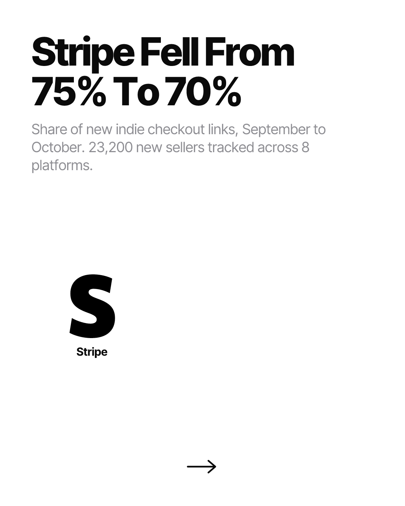
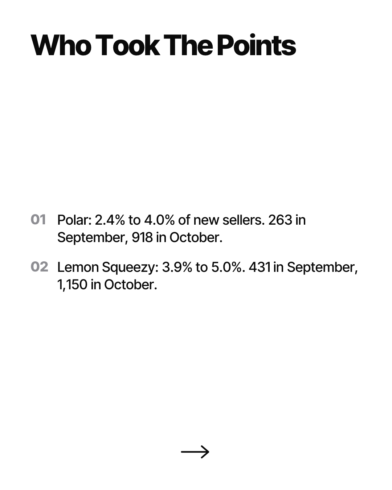
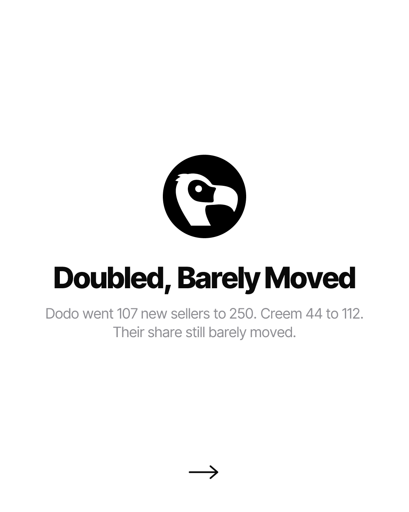
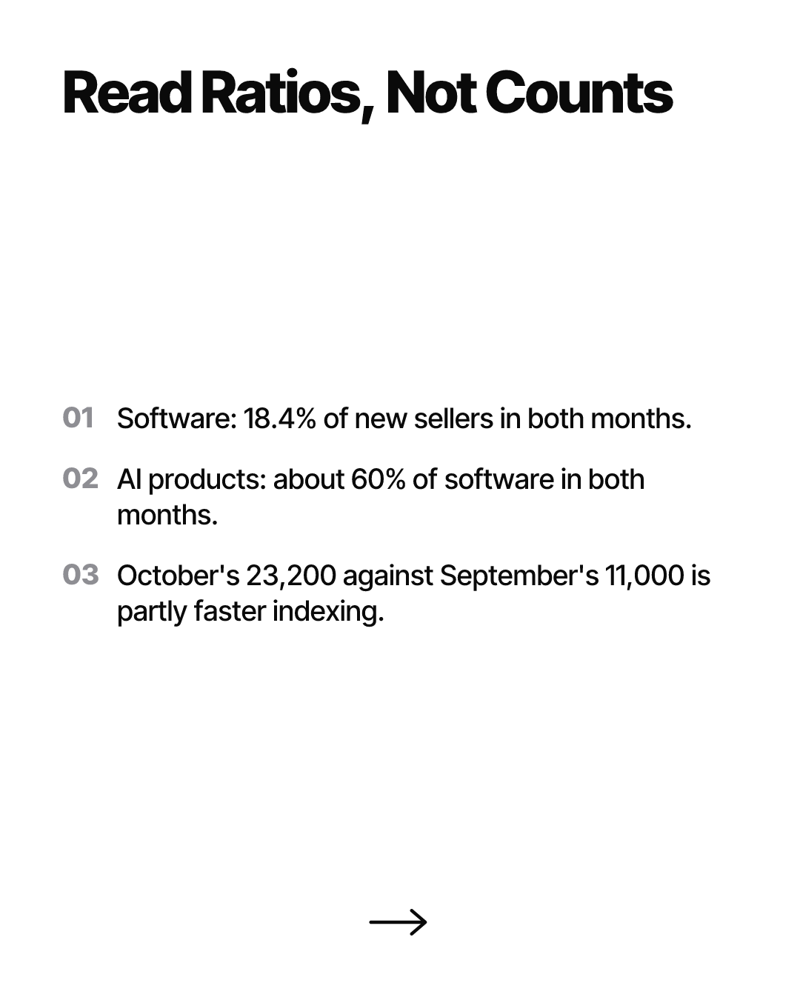
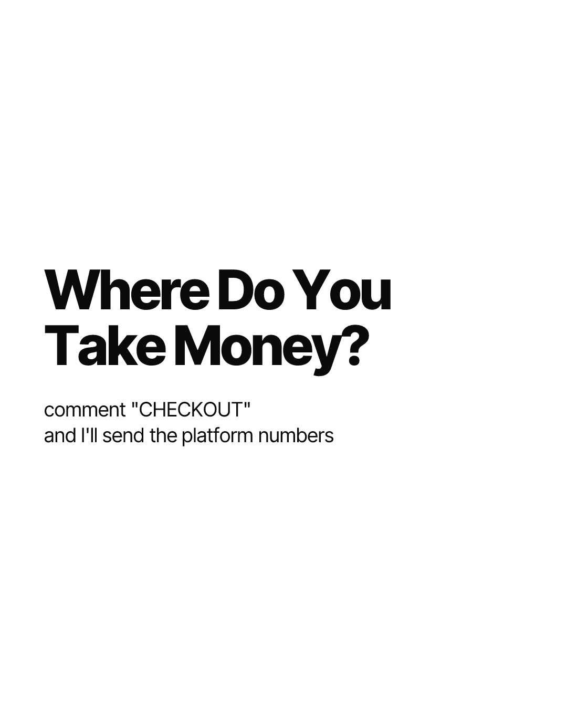

# Pending Notion row — "Instagram Carousel & Post Pipeline"

Could not be filed automatically. The Notion connector is disconnected for this session: a tool
search for Notion returns no tools at all, so there is no API path to the database. No .env file
and no NOTION_TOKEN exist in this environment either, so the scripted path (src/notion.ts) is
also unavailable.

This is the TWELFTH consecutive day it has failed. Reconnect at
claude.ai -> Settings -> Connectors -> Notion. Backlog to paste, oldest first:
  NOTION-ROW-2026-10-23.md
  NOTION-ROW-2026-10-24.md
  NOTION-ROW-2026-10-25.md
  NOTION-ROW-2026-10-26.md
  NOTION-ROW-2026-10-27.md
  NOTION-ROW-2026-10-28.md
  NOTION-ROW-2026-10-29.md
  NOTION-ROW-2026-10-30.md
  NOTION-ROW-2026-10-31.md
  NOTION-ROW-2026-11-01.md
  NOTION-ROW-2026-11-02.md
  NOTION-ROW-2026-11-03.md  (this file)

Everything below is final, rendered, pushed, and every slide URL verified HTTP 200.
Paste as one new row.

---

## Topic
Stripe Fell From 75% To 70%

## Ready to Post
unchecked

## Image URL (slide 1)
https://raw.githubusercontent.com/SouSingh/ig-content-engine/main/posts/ig/2026-11-03/stripe-fell-75-to-70/01.png

## Bio

I picked my checkout provider in 2021 and have not looked at the decision since.

Jason Zhu counts new checkout links across 8 payment platforms every week. In October, Stripe took 70% of new indie sellers, down from 75% in September. Polar went 2.4% to 4.0%, Lemon Squeezy 3.9% to 5.0%. Dodo and Creem more than doubled in count and still barely moved in share.

His own caveat is the part I keep failing to apply to my own dashboards: October's 23,200 new sellers against September's 11,000 is partly just the index crawling faster. The ratios moved. The headline number is softer than it looks.

Where do you take money?

#indiehackers #solofounder #buildinpublic #saas #microsaas #solopreneur #stripe #polar #lemonsqueezy #payments #indiedev #bootstrapping

---

## Page body

### Carousel (embed each as an image block, in order)

### Raw URLs (for downloading)

https://raw.githubusercontent.com/SouSingh/ig-content-engine/main/posts/ig/2026-11-03/stripe-fell-75-to-70/01.png
https://raw.githubusercontent.com/SouSingh/ig-content-engine/main/posts/ig/2026-11-03/stripe-fell-75-to-70/02.png
https://raw.githubusercontent.com/SouSingh/ig-content-engine/main/posts/ig/2026-11-03/stripe-fell-75-to-70/03.png
https://raw.githubusercontent.com/SouSingh/ig-content-engine/main/posts/ig/2026-11-03/stripe-fell-75-to-70/04.png
https://raw.githubusercontent.com/SouSingh/ig-content-engine/main/posts/ig/2026-11-03/stripe-fell-75-to-70/05.png

### Sources

Primary source for every number on the slides:
- https://jasonzhu.ai/en/blog/chuhai-weekly-04
  (Indie Seller Weekly #4, Jason Zhu, published 2 November 2026. Counts new checkout links
  across 8 payment platforms — Stripe, Gumroad, Lemon Squeezy, Polar, Creem, Dodo, Paddle,
  Waffo — from DataForSEO's link graph. Supplies: Stripe 75% -> 70%; Polar 2.4% -> 4.0%
  (263 -> 918); Lemon Squeezy 3.9% -> 5.0% (431 -> 1,150); Dodo 107 -> 250; Creem 44 -> 112;
  October 23,200 new sellers vs September 11,000; software 18.4% of new sellers in both
  months; AI products about 60% of software in both months; and the author's own caveat that
  part of the October jump is the link graph indexing faster.)

Candidates researched and dropped (all opened, not just search snippets):
- https://www.testmuai.com/research/state-of-ai-in-quality-engineering/
  TestMu AI, State of AI in Quality Engineering 2026, published 2 Nov 2026. Strong numbers
  (81% merged AI code they didn't understand; 3:1 generate-vs-verify spend; 13% have an
  incident plan). DROPPED for topic saturation — the "AI code is unreliable, here's a stat"
  angle ran on 10-19, 10-20, 10-25, 10-27, 10-28 and 11-02. Best candidate for a later date
  once that beat has rested.
- https://vercel.com/changelog/data-cache-is-moving-to-runtime-cache
  Vercel Data Cache -> Runtime Cache, 30 Oct 2026. Previously unbilled reads/writes now
  metered at $0.40/M read units and $4.00/M write units; Hobby migrates 29 Nov. DROPPED as a
  near-repeat of 2026-10-10 "Your Rollbacks Expire October 23" — same vendor, same shape
  (Vercel meters a previously free thing, with a deadline).
- https://aiweekly.co/alerts/harvard-study-ai-coding-agents-add-30-code-flat-shipped-output
  Harvard/Jellyfish 700-firm study. DROPPED — already shipped on 2026-10-19
  ("agents-made-review-49-slower").
- https://saasearch.io/reports/weekly/2026-w44
  671 indie SaaS launches Oct 26 - Nov 1; median entry price $10/mo, down from $12; AI
  products 19% of launches, up from 10%. DROPPED — thinner and less specific than the
  payment-platform story, and a launch-volume roundup is a weak carousel.
- https://www.infoq.com/news/2026/10/atlassian-devex-2026/ and
  https://www.atlassian.com/teams/software-development/state-of-developer-experience-2026
  Atlassian State of DevEx 2026: developers reporting 10+ hours/week saved fell from 68% to
  26%. Not previously covered, but vendor research, no fieldwork dates published, and a
  shrunken comparison base — and it is the same "AI productivity stat" beat as above.
- https://www.ibtimes.com/ai-agents-help-entrepreneurs-run-businesses-alone-3809273
  Stripe solopreneur data: $1M+ solopreneurs more than doubled 2023-2025; Stripe Atlas median
  first-six-month revenue for solo founders down 23% while top 10% rose 19%; 63% of Q2 2026
  Atlas C-corps had no cofounder. DROPPED — overlaps 2026-10-01 ("The Median Earner Made
  $169"), which already ran the median-vs-top-tier split.
- https://aifounderweekly.news/issues/2026-11-02-w7
  Marc Lou's $105,147 October across 16 products; his read of 758 startups above $1k MRR
  showing median growth 0% for B2B vs -6.2% for B2C. DROPPED — single-founder revenue
  screenshots are self-reported and the portfolio-flex angle is off-voice.
- https://github.com/anthropics/claude-code/releases
  Claude Code 2.1.317 (3 Nov) adds a check before a web or shell tool call sends your account
  email to the network, and a /schedule warning for unrequested connectors. Held as a
  candidate for a later post; the changelog beat ran heavily in late October.

### Production notes

- Shape chosen: 5-slide tool-stack / platform-share post (cover, list, feature, list, cta).
  The last twelve posts ran 4/5/5/7/6/5/7/4/7/6/8/6 slides and were dominated by AI-agent
  reliability stats, benchmark leaderboards and security teardowns. A platform-share story is
  a beat that has not run at all recently, and it is the one candidate where the house rule of
  logos-only imagery actually carries information rather than decorating.
- Not padded to 7: the source supports exactly four substantive beats (Stripe's fall, the two
  real gainers, the small-base doublers, and the ratios-not-counts caveat). A fifth would have
  been filler.
- Icon constraint discovered during render: Polar and Creem have NO simple-icons mark.
  `siPolars` in the package is the Polars dataframe library, a different brand — deliberately
  not used. Both brands are therefore carried as TEXT in list slides so nothing falls back to
  a lettermark box. Only `stripe` and `dodopayments` are used as icons; both were confirmed to
  resolve to real marks (cached SVGs carry <title>Stripe</title> and <title>Dodo Payments</title>).
- Brandfetch returned 403 "the plan behind this API key includes no API credits" on
  get_brand_data, so no primary hex was available. Per the brief, the colour field is omitted
  and logos render default near-black. This is also the better outcome here: Dodo's brand lime
  (#C6FE1E) and Lemon Squeezy's yellow (#FFC233) are near-invisible on a white background and
  would have broken the house style. Brand existence was still confirmed via brand_search,
  which does not consume credits (Dodo Payments / dodopayments.com, claimed + verified;
  Polar / polar.sh, lettermark fallback only — consistent with it having no real mark).
- QA: all five PNGs opened and inspected at 1080x1350. One fix applied after first render —
  slide 2's two list items were too short, leaving an unbalanced void under the headline and
  an ambiguous "263 to 918"; rewritten to name the month for each count, then re-rendered and
  re-inspected.
- Push note: the clone was in detached HEAD with a stale local `main` ref, so `git push origin
  main` was rejected as behind. Resolved with a plain fast-forward `git push origin HEAD:main`
  (383d4d2..382c568) after confirming origin/main was an ancestor of HEAD. No force push.
